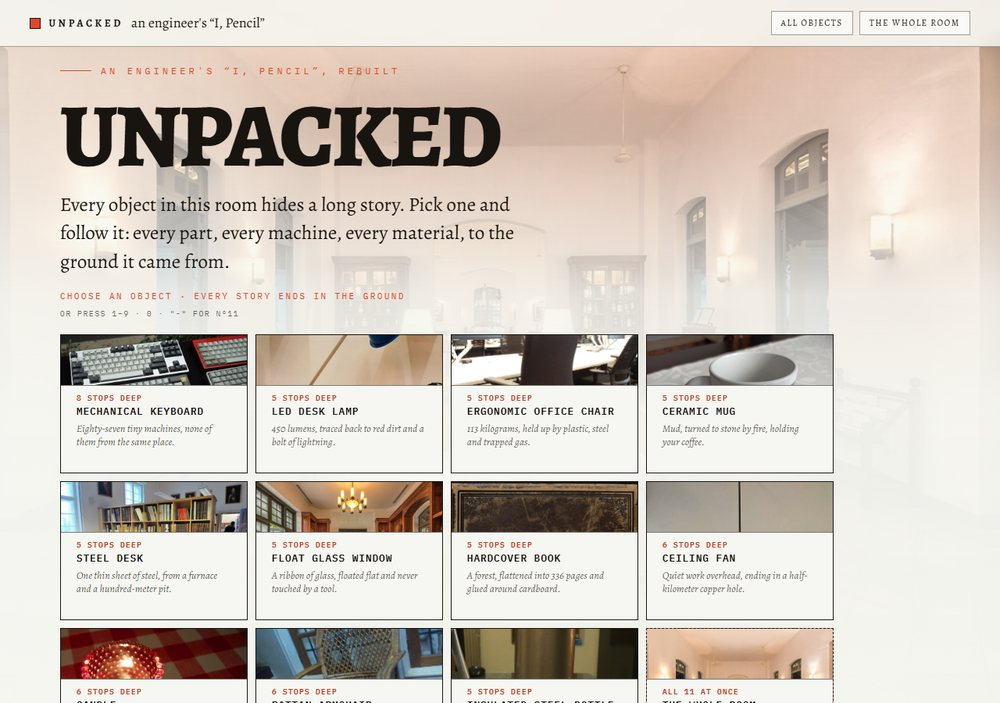
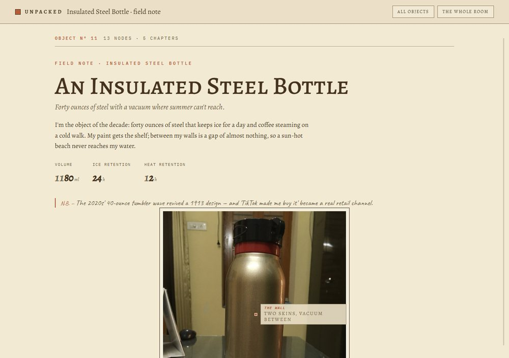

# UNPACKED

**Everything in an ordinary room, traced all the way down to the ground it came from.**

Live: **[0xhzsa.github.io/unpacked](https://0xhzsa.github.io/unpacked/)**

It is an interactive, scroll-through field note — an engineer's answer to *"I, Pencil."*
You start in one ordinary room. Pick any of the 11 objects and the story walks you down
its supply chain: the part, the machine that made it, the material the machine shaped,
until you reach the mine, oil well, forest or quarry it finally came from.

**11 objects · 106 processes · 121 links · 9 shared sources**
One place where the steel desk, the hardcover book and the ceiling fan all spill into
*the same iron mine*.

## How to use it

- **Click any object card** on the home sheet — each opens a scroll story
  (the whole object's journey is one page; chapter plates flag the machine parts).
- **Appendix** at the end: every node in the chain with its verified specs, process
  and history in ledger form. Nothing in the picture is left unexplained.
- **The whole room** (button top-right, `G`, or the dashed card): all 106 processes
  in one graph — see where the 11 chains merge, split and reuse each other.
- **Keyboard**: `1–9` and `0` open objects Nº1–10, `-` opens Nº11, `G` = whole room,
  `Escape` backs out one layer. Every story also has a **real URL**: open one and the
  address becomes `/#obj/<id>`, "Copy link" copies it, and the `story/` door pages
  (one per object) carry the object's own link-preview card when a link is shared.
- Machine chapters can **run the 30-second injection cycle** as a live simulation.

## What's in the box

Zero frameworks. One flat pile of browser JS (`content.js`, `journey.js`, `descent.js`,
`story.js`, `graph.js`, `press.js`, `affiliate.js`), one stylesheet, and 51 Wikimedia
photographs (CC BY / CC BY-SA — credits per file in `RECOVERY-NOTE.md`, strip on the home page).
Everything is a static file; deploy is any static host.

| Home sheet | Story | Appendix ledger |
| --- | --- | --- |
|  |  | — |

## Fact discipline

Every number on the site is either verified against a manufacturer/source
(e.g. Thermos publishes *24 h cold / 12 h hot*; Stanley's 2019→2023 arc is CNBC's $73M→$750M)
or phrased qualitatively. The rule from `AUTHORING.md` holds: *no number you can't defend.*
Found something wrong? Open an issue — the fact-check pass is ongoing.

## Own it / monetize

The site ships **unmonetized**. To turn purchases on, edit one file —
`js/affiliate.js`: set `tag: "yourtag-20"` and "Where to get one" buttons appear on
every object's first chapter, with the required disclosure line included.
Per-object search terms and direct-store URLs are already configured; an empty tag
keeps the site fully functional, simply without buy buttons.

## Develop & verify

```bash
# static server
npx serve .            # or: node serve.js

# screenshot any state (headless, with geometry check)
node shot.js "http://127.0.0.1:8931/" 1280 900 shot.png 5500

# validate chains + image references
node check-journey.js
node check-imgs.js
```

`tools/og.html` is the live-draft for the social share card: screenshot that page at
1200×630 and recompress to `assets/og.jpg` when the roster of objects changes.

## History

Built iteratively in sessions logged in [`RECOVERY-NOTE.md`](RECOVERY-NOTE.md):
content chains → story mode → fact-checking → performance → the specimen-plate home
sheet. The design language (`brand.md`) is deliberate: parchment and ink, small-caps
field labels, handwriting margin notes, hairline ledger rules — no shadows, no radii,
one accent.
