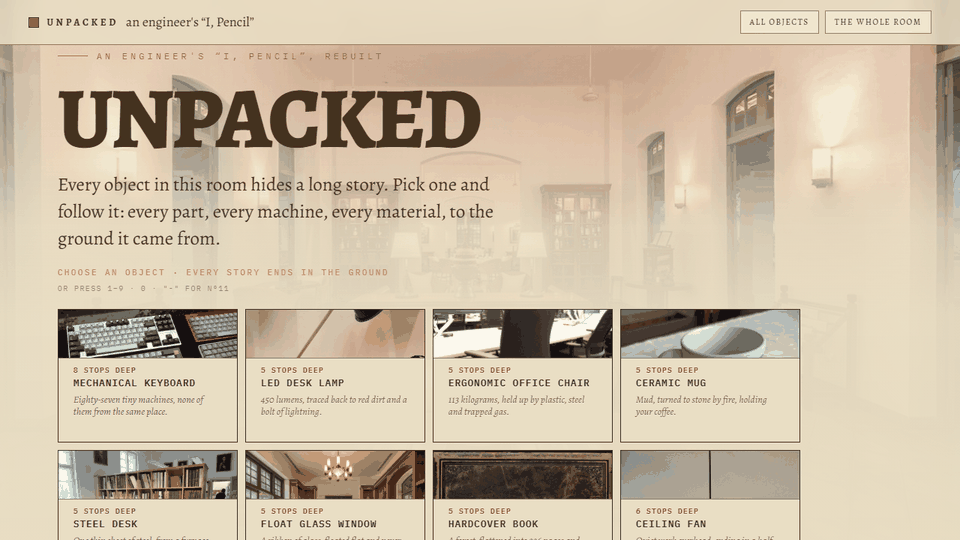

# UNPACKED

**Everything in an ordinary room, traced all the way down to the ground it came from.**

Live: **[0xhzsa.github.io/unpacked](https://0xhzsa.github.io/unpacked/)**

**The mechanic, in ten seconds**: the home sheet &rarr; an object's scroll story &rarr;
the live 30-second press cycle &rarr; the whole-room supply-chain graph.



It is an interactive, scroll-through field note — an engineer's answer to *"I, Pencil."*
You start in one ordinary room. Pick any of the 24 objects and the line walks you down
its supply chain: the part, the machine that made it, the material the machine shaped,
until you reach the mine, oil well, forest or quarry it finally came from.

**24 objects · 232 processes · 15 grounds**
Five lines end in crude oil, three in iron ore, two in copper. The steel desk, the insulated bottle and the cast-iron skillet all end in
*the same iron ore mine*.

## How to use it

- **Pick an object** on the wall — its card opens the line at the room, then every stop
  is a station sheet: the number that matters, what happens there, what feeds it, what
  it feeds, the verified specs and the history.
- **Transit map** ("TRANSIT MAP" in the header, or on any line): all 24 lines on one
  diagram — see where they merge, split and reuse each other.
- **Keyboard**: `→` / `Enter` / `Space` advance a stop, `←` backs up, `Escape` returns
  to the wall. Every view is a real URL: `/#/line/<id>`, `/#/stop/<id>`,
  `/#/station/<id>`, `/#/ground/<id>`, and "SHARE THE CARD" renders the line as an image.
- **Link previews**: each object has a `story/<id>/` door page carrying its own 1200×630
  card, so a shared link opens with the object, not the homepage.

## What's in the box

Zero frameworks. One flat pile of browser JS (`content.js`, `journey.js`, `beats.js`,
`meta.js`, `imgmap.js`, `app.js`), two stylesheets, and 97 Wikimedia photographs
(CC BY / CC0 / public domain — credits per file in `RECOVERY-NOTE.md`, strip on the
home page). Everything is a static file; deploy is any static host.

| Home sheet | Story | Appendix ledger |
| --- | --- | --- |
|  |  | — |

## Fact discipline

Every number on the site is either verified against a manufacturer/source
(e.g. Thermos publishes *24 h cold / 12 h hot*; Stanley's 2019→2023 arc is CNBC's $73M→$750M)
or phrased qualitatively. The rule from `AUTHORING.md` holds: *no number you can't defend.*
Found something wrong? Open an issue — the fact-check pass is ongoing.

## Own it / monetize

The site ships **unmonetized**. To turn purchases on, edit one file —
`js/affiliate.js`: set `tag: "yourtag-20"` and "Where to get one" buttons appear on
every object's first chapter, with the required disclosure line included.
Per-object search terms and direct-store URLs are already configured; an empty tag
keeps the site fully functional, simply without buy buttons.

## Develop & verify

```bash
# static server
npx serve .            # or: node serve.js

# screenshot any state (headless, with geometry check)
node shot.js "http://127.0.0.1:8931/" 1280 900 shot.png 5500

# validate chains + image references
node check-journey.js
node check-imgs.js

# regenerate the demo GIF: frames.js keeps one headless page alive and drives
# the whole mechanic (home -> story -> press cycle -> ledger -> graph)
node frames.js "http://127.0.0.1:8931/" 1280 720 "%TEMP%/frames" 4200
# then resize/quantize the captured PNGs into docs/demo.gif
```

`tools/og.html` is the live-draft for the social share card: screenshot that page at
1200×630 and recompress to `assets/og.jpg` when the roster of objects changes.

## History

Built iteratively in sessions logged in [`RECOVERY-NOTE.md`](RECOVERY-NOTE.md):
content chains → story mode → fact-checking → performance → the specimen-card home
grid. The design language (`brand.md`) is deliberate: parchment and ink, small-caps
field labels, handwriting margin notes, hairline ledger rules — no shadows, no radii,
one accent.
